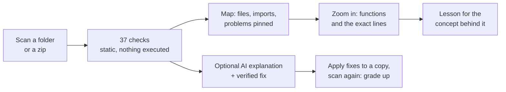

# Shipshape


**Code is cheap now. Judgment isn't.**

Shipshape reviews vibe-coded Python projects the way a careful senior engineer would, shows every problem on a map of your own code, explains it in plain language, and applies fixes it has verified, so you end up with code a team would accept and the judgment behind it.

It is built first for people whose code gets judged by someone else (researchers, students, domain experts) and knows research-specific pitfalls: data leakage across subjects, missing random seeds, hard-coded data paths, unpinned environments. It never runs your code.

## What it does



- **Find.** 26 custom checks plus 11 curated ruff rules, including PyTorch training-loop bugs (no `zero_grad`, no `eval()`, the test set used to pick the best epoch), in six dimensions (correctness, structure, reproducibility, readability, testing, security), with a scorecard and grade. Every check is measured against a corpus of small projects with planted problems: all found, no false positives. Files Shipshape cannot read are listed in every report, so nothing is skipped silently, and every report also says which dimensions are already in good shape.
- **See.** An architecture map of folders, files and imports, with each finding pinned where it happens, missing pieces (no tests, no environment file) drawn as ghosts, and data read from outside the project. Double-click a file to zoom into its functions and classes, then into the code with the flagged lines marked.
- **Understand.** With an LLM key, each finding gets a plain-language explanation of what is going on in *this* code, why it matters, and how to fix it. Every finding also links to a hand-written lesson on the concept behind it (26 lessons, from data leakage to training loops), with a before and after and an honest note on what Shipshape cannot detect.
- **Fix.** Proposed fixes are only shown if, applied in memory, the code still parses, the problem is gone and no other check finds anything new. Tick the ones you want and press "Apply": they are applied one at a time to a copy, each verified again against the code the earlier ones left. A fix that collides with an earlier one is regenerated against the fixed code in a second round. The copy is scanned again and a before/after page shows the grade and every score, with a `git apply` patch or a fixed zip to download. Your files are never changed.
- **Track.** A local profile shows which concepts keep coming up across your projects and which you have resolved, built only from your scan history.
- **Export.** Findings, explanations and fixes as Markdown, JSON or CSV, with or without AI.
- **Let an agent do it.** From the web app (watch every step live) or with `shipshape agent`, an LLM works through the findings with tools: it reads the code, proposes one fix at a time, and Shipshape verifies each before applying it to a copy. Step and cost limits, a stop after repeated rejections, and a step-by-step log keep it under control.
- **Or inside Claude Code.** A plugin brings the checks, the fix verification and the lessons into Claude Code, with Claude as the LLM, so no API key is needed. See [Four ways to use it](#four-ways-to-use-it).

## Shipshape reviewed itself

The first time Shipshape scanned its own repository, it found a bug in itself: its complexity check counted every class method twice, because the library it uses (radon) lists methods both inside their class and at the top level. The fix keeps one entry per definition, with a regression test. The same scan then pointed at Shipshape's two most tangled functions (complexity 25 and 23), which were split up on its advice. Its own self-scan now grades **A**, with the deliberately broken test projects visibly declared out of scope in `.shipshapeignore` so the score stays traceable.

## Privacy

Everything runs on your machine. Without an LLM key nothing leaves it. With a key, only the finding and the code around it are sent for explanations; credentials are redacted first, `.env` files are never sent, and every run prints which provider receives the code and what it cost. Where the code goes depends on the provider you pick: DeepSeek, for example, runs its servers in China, so check your provider's terms before using AI explanations on code you may not share. With a local model (Ollama, vLLM) nothing leaves your machine at all. Answers are cached, so unchanged code is never paid for twice. In the Claude Code plugin, the engine still runs locally, and your code is read by Claude under your own Claude plan, like any other code you open in Claude Code.

## Four ways to use it

| | Web app | Command line | Claude Code plugin | MCP server in other clients |
|---|---|---|---|---|
| **Best for** | Seeing your project: map, code, before/after, the agent live | Scripts, CI, quick checks | Working on code you already have open in Claude Code | Any MCP client (Claude Desktop and others) |
| **Needs** | conda (or Python 3.11+), Node.js 22 | conda (or Python 3.11+) | Claude Code and [uv](https://docs.astral.sh/uv/) | uv |
| **AI** | Optional, your key (any OpenAI-compatible provider) | Optional, your key | Claude, under your Claude plan | That client's model |
| **Your files** | Never changed; fixes go to a copy, patch or zip | Never changed; patch or zip | Claude edits them after `verify_fix` passed (commit first) | As the client decides |

### 1. Web app

```bash
conda env create -f environment.yml
conda activate shipshape
cd web && npm ci && npm run build && cd ..   # build the web app once
shipshape-api                                # from the repository root; open http://127.0.0.1:8000
```

Paste a project folder (or upload a zip) and press *Start scan*. The review shows the map, the findings and the code; tick verified fixes and press *Apply*, or press **Agent** to let the agent work through the project while you watch every step. The server binds to 127.0.0.1 only, and on Windows each new terminal starts in conda's `base`, so run `conda activate shipshape` first.

### 2. Command line

Same environment as the web app (no Node.js needed):

```bash
shipshape analyze path/to/project                 # findings and scorecard
shipshape analyze path/to/project --explain       # plus explanations and verified fixes
shipshape analyze path/to/project --export report.md   # Markdown, JSON or CSV
shipshape fix path/to/project --patch fixes.patch # apply verified fixes to a copy, write a patch
shipshape agent path/to/project --patch agent.patch --log agent.md   # the agent, every fix verified
shipshape map path/to/project --html map.html     # quick standalone map
shipshape lessons data-leakage                    # the lesson behind a check
```

### 3. Claude Code plugin

Inside Claude Code:

```
/plugin install shipshape --marketplace OmarAbuLayla/shipshape
```

Claude explains the findings and writes the fixes; Shipshape's engine runs locally as an MCP server and supplies the findings, the grade, the lessons, and the check every fix must pass. Ask for a review in your own words, or use `/shipshape:review`, `/shipshape:fix` and `/shipshape:lesson data-leakage`. The bundled `shipshape-reviewer` subagent does a whole review in its own context and returns a short report. The **first start** after installing or updating builds the engine with `uvx` and can take a minute; if Claude Code gives up on the server, see the [plugin README](plugin/README.md#if-the-server-times-out-on-first-start). The plugin pins the engine to a release tag, so updates happen only when you update the plugin.

### 4. MCP server in other clients

The same four tools (`scan`, `verify_fix`, `lesson`, `map`) work in any MCP client that can start a local stdio server. Add this to the client's MCP configuration (for Claude Desktop, `claude_desktop_config.json`):

```json
{
  "mcpServers": {
    "shipshape": {
      "command": "uvx",
      "args": ["--from", "git+https://github.com/OmarAbuLayla/shipshape@v0.8.1#subdirectory=engine", "shipshape-mcp"]
    }
  }
}
```

With the conda environment installed, `"command": "shipshape-mcp"` with no arguments works too. Other clients get the tools but not the Claude Code skills or the subagent; so far Shipshape has been tested in Claude Code only.

### AI providers (web app and command line)

For explanations, fixes and the agent, copy `.env.example` to `.env`, pick a provider, add its key and check it with `shipshape llm-check --ping`. Any service that speaks the OpenAI chat format works (JSON mode for explanations, tool calling for the agent):

| Provider | `SHIPSHAPE_LLM_PROVIDER` | Key and endpoint |
|---|---|---|
| DeepSeek (default; cheapest we found, about $0.02 for a small project) | `deepseek` | `DEEPSEEK_API_KEY` |
| OpenAI | `openai` | `OPENAI_API_KEY`, and set `SHIPSHAPE_LLM_MODEL` |
| OpenRouter, Mistral, Groq, Together, a local Ollama or vLLM, ... | `openai-compatible` | `SHIPSHAPE_LLM_BASE_URL`, `SHIPSHAPE_LLM_API_KEY` and `SHIPSHAPE_LLM_MODEL` |

Cost estimates are shown for DeepSeek's models only; other providers report tokens. The prompts were tuned and measured with DeepSeek, so quality with other models may differ (weaker models get fewer fixes through verification). Run `shipshape-api` from the repository root so it finds `.env`.

## The agent

The agent is an LLM working through a project with four tools: list the findings, read a file, propose a fix, finish. The model decides what to look at and what to change; **Shipshape decides what is accepted**. Every proposed fix goes through the same gates as the verified fixes (the code still parses, the problem is gone, no other check finds anything new) and is applied only if it passes, to an in-memory copy, so the next step sees the improved code. A rejected fix comes back with the reason, and the model can try once more.

Guard rails keep it predictable: a limit on model turns (30) and on estimated cost ($0.10), a stop after three rejected fixes for the same finding, at most three files per proposed fix, and instructions to keep the program's behaviour the same (no removed options, warnings rather than new errors in research code). Credentials are hidden from everything the model reads; a line holding a secret can be replaced by line number without the model ever seeing the value. Every step is shown live in the web app (or printed by the CLI) and kept as a log, and the run ends with the model's own summary of what it changed, what it left for you and every change in behaviour.

On the small `heart_risk` test project a run takes one to two minutes and about $0.03 and moves the grade from D to B. On an 8,000-line research project it fixed 7 problems across 18 files (silently skipped data folders, imports that only worked on the author's machine) for about $0.06, and left the decisions (where configuration should live, which copied files are the real ones) to the author. In the Claude Code plugin, Claude itself plays this role with the same `verify_fix` check.

## Leaving things out

To leave generated or example code out of the review, list it in a `.shipshapeignore` file (gitignore syntax); every report says what was left out. The [engine README](engine/README.md) lists every check and its limits, the [API README](api/README.md) the endpoints, and the [web README](web/README.md) the screens.

## How it is built

| Part | Stack |
|---|---|
| `engine/` | Python 3.11, pydantic models, ruff and radon plus custom AST checks, an import resolver and graph builder, LLM layer (OpenAI-compatible API, JSON mode, redaction, in-memory fix verification, cache), typer CLI |
| `api/` | FastAPI, background scan workers, SQLite history, safe zip uploads, serves the built web app; binds to 127.0.0.1 only |
| `plugin/` | Claude Code plugin: three skills (review, fix, lesson), a reviewer subagent and the MCP server config, pinned to an engine release; the engine's `shipshape-mcp` serves `scan`, `verify_fix`, `lesson` and `map` over stdio |
| `web/` | React 18 and TypeScript, React Flow with ELK layout for the map and block views, Vite |
| `docs/` | [Roadmap](docs/ROADMAP.md) and the [fixture corpus](docs/corpus.md) used to measure the checks |

Development:

```bash
cd engine && ruff check . && mypy && pytest          # engine (includes the corpus evaluation)
cd api && ruff check . && mypy && pytest             # API
cd web && npm run lint && npm run typecheck && npm test && npm run build
cd web && npm run dev                                # hot-reloading UI on :5173 (API on :8000)
```

CI runs all three on every push.

## Limits, honestly

The checks are static heuristics tuned on a small corpus: the leakage check recognises common split patterns, not leakage hidden in custom code or in how the data was collected, so it is phrased as a question. "Verified" fixes are valid and remove the problem without adding detectable new ones, but Shipshape never runs code, so it cannot prove behaviour is unchanged; run your tests after applying. The map shows imports and literal file paths, not true data flow. Only Python (and notebooks) is supported.

## Status

Done so far: analysis engine, architecture map, explanations with verified fixes, the web app, applying fixes, function blocks, lessons and a profile, the Claude Code plugin, and the agent (web app, command line, and a reviewer subagent in the plugin). See the [roadmap](docs/ROADMAP.md).

## License

MIT, see [LICENSE](LICENSE).
