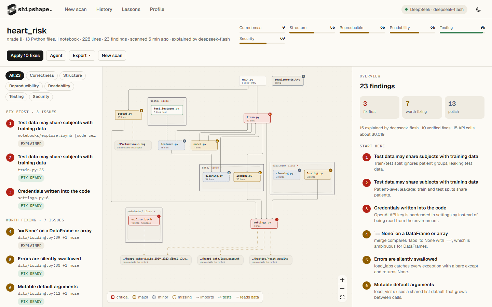
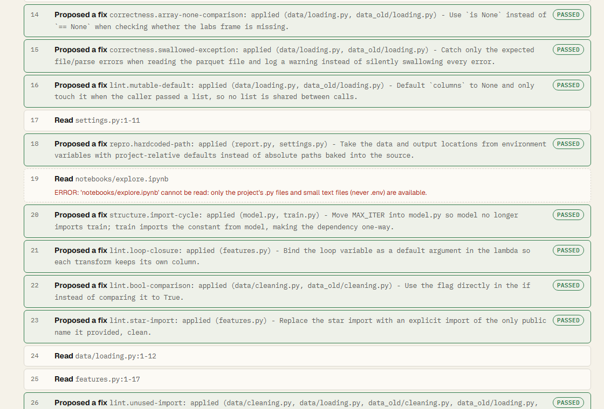

# Shipshape

**Code is cheap now. Judgment isn't.**

Shipshape reviews AI-written Python projects the way a careful senior engineer would, and fixes them with changes it has verified first.



## Why

AI writes code in minutes, but someone still has to judge it, and the people whose code gets judged (researchers, students, domain experts) rarely have a senior engineer next to them. Shipshape finds what that engineer would object to, from data leakage across patients to missing seeds and silently skipped data, explains it in your own code, and teaches the idea behind it.

## What makes it different

- **It never runs your code.** 37 static checks, measured on projects with planted bugs.
- **Every fix is verified before you see it.** The code must still parse, the problem must be gone, and no other check may find anything new. Your files are never changed.
- **An agent can do the work, and Shipshape decides what is accepted.** The agent reads your code and proposes fixes; only verified ones are applied, and you watch every step.



## Try it

Requires [conda](https://docs.conda.io/) and Node.js 22.

```bash
conda env create -f environment.yml
conda activate shipshape
cd web && npm ci && npm run build && cd ..
shipshape-api          # open http://127.0.0.1:8000
```

Paste a project folder and press *Start scan*. For AI explanations and the agent, copy `.env.example` to `.env` and add an API key.

**Other ways to use it:** the command line, a Claude Code plugin (no API key needed), and other MCP clients. See the [usage guide](docs/usage.md).

## More

- [Usage guide](docs/usage.md): the four ways to use Shipshape, AI providers, the agent
- [How it works](docs/how-it-works.md): checks, verification, the agent, and how Shipshape found bugs in itself
- [Privacy and limits](docs/how-it-works.md#privacy): what leaves your machine, and what Shipshape cannot do
- [Development](docs/development.md): project layout and tests

MIT licensed.
