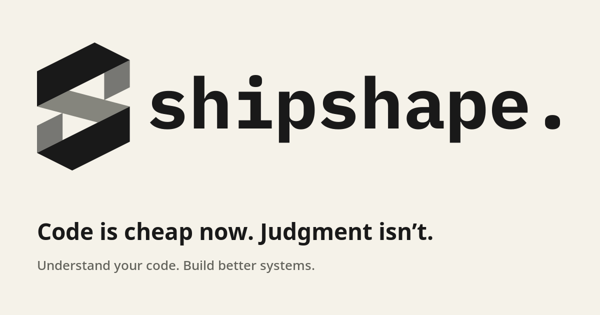

# Shipshape



**Code is cheap now. Judgment isn't.**

Shipshape reviews vibe-coded Python projects the way a careful senior engineer would, shows every problem on a map of your own code, explains it in plain language, and applies fixes it has verified, so you end up with code a team would accept and the judgment behind it.

It is built first for people whose code gets judged by someone else (researchers, students, domain experts) and knows research-specific pitfalls: data leakage across subjects, missing random seeds, hard-coded data paths, unpinned environments. It never runs your code.

## What it does


- **Find.** 18 custom checks plus 11 curated ruff rules, in six dimensions (correctness, structure, reproducibility, readability, testing, security), with a scorecard and grade. Every check is measured against a corpus of small projects with planted problems: all found, no false positives.
- **See.** An architecture map of folders, files and imports, with each finding pinned where it happens, missing pieces (no tests, no environment file) drawn as ghosts, and data read from outside the project. Double-click a file to zoom into its functions and classes, then into the code with the flagged lines marked.
- **Understand.** With an LLM key, each finding gets a plain-language explanation of what is going on in *this* code, why it matters, and how to fix it. Every finding also links to a hand-written lesson on the concept behind it (25 lessons, from data leakage to mutable defaults), with a before and after and an honest note on what Shipshape cannot detect.
- **Fix.** Proposed fixes are only shown if, applied in memory, the code still parses, the problem is gone and no other check finds anything new. Tick the ones you want and press "Apply": they are applied one at a time to a copy, each verified again against the code the earlier ones left. A fix that collides with an earlier one is regenerated against the fixed code in a second round. The copy is scanned again and a before/after page shows the grade and every score, with a `git apply` patch or a fixed zip to download. Your files are never changed.
- **Track.** A local profile shows which concepts keep coming up across your projects and which you have resolved, built only from your scan history.
- **Export.** Findings, explanations and fixes as Markdown, JSON or CSV, with or without AI.
- **Or inside Claude Code.** A plugin brings the checks, the fix verification and the lessons into Claude Code, with Claude as the LLM, so no API key is needed.

## Shipshape reviewed itself

The first time Shipshape scanned its own repository, it found a bug in itself: its complexity check counted every class method twice, because the library it uses (radon) lists methods both inside their class and at the top level. The fix keeps one entry per definition, with a regression test. The same scan then pointed at Shipshape's two most tangled functions (complexity 25 and 23), which were split up on its advice. Its own self-scan now grades **A**, with the deliberately broken test projects visibly declared out of scope in `.shipshapeignore` so the score stays traceable.

## Privacy

Everything runs on your machine. Without an LLM key nothing leaves it. With a key, only the finding and the code around it are sent for explanations; credentials are redacted first, `.env` files are never sent, and every run prints which provider receives the code and what it cost. Where the code goes depends on the provider you pick: DeepSeek, for example, runs its servers in China, so check your provider's terms before using AI explanations on code you may not share. With a local model (Ollama, vLLM) nothing leaves your machine at all. Answers are cached, so unchanged code is never paid for twice. In the Claude Code plugin, the engine still runs locally, and your code is read by Claude under your own Claude plan, like any other code you open in Claude Code.

## Getting started

Requires [conda](https://docs.conda.io/) (or Python 3.11+) and Node.js 22.

```bash
conda env create -f environment.yml
conda activate shipshape
cd web && npm ci && npm run build && cd ..   # build the web app once

shipshape-api                                # open http://127.0.0.1:8000
```

For AI explanations, copy `.env.example` to `.env`, pick a provider, add its key and check it with `shipshape llm-check --ping`. Any service that speaks the OpenAI chat format with JSON mode works:

| Provider | `SHIPSHAPE_LLM_PROVIDER` | Key and endpoint |
|---|---|---|
| DeepSeek (default; cheapest we found, about $0.02 for a small project) | `deepseek` | `DEEPSEEK_API_KEY` |
| OpenAI | `openai` | `OPENAI_API_KEY`, and set `SHIPSHAPE_LLM_MODEL` |
| OpenRouter, Mistral, Groq, Together, a local Ollama or vLLM, ... | `openai-compatible` | `SHIPSHAPE_LLM_BASE_URL`, `SHIPSHAPE_LLM_API_KEY` and `SHIPSHAPE_LLM_MODEL` |

Cost estimates are shown for DeepSeek's models only; other providers report tokens. The explanations and fixes were tuned and measured with DeepSeek, so quality with other models may differ (weaker models get fewer fixes through verification). Run `shipshape-api` from the repository root so it finds `.env`.

The command line works without the web app:

```bash
shipshape analyze path/to/project                 # findings and scorecard
shipshape analyze path/to/project --explain       # plus explanations and verified fixes
shipshape fix path/to/project --patch fixes.patch # apply verified fixes to a copy, write a patch
shipshape map path/to/project --html map.html     # quick standalone map
shipshape lessons data-leakage                    # the lesson behind a check
```

## In Claude Code

Shipshape also runs as a [Claude Code](https://code.claude.com) plugin. Claude explains the findings and writes the fixes; Shipshape's engine runs locally as an MCP server and supplies the findings, the grade, the lessons, and a check every fix must pass before Claude applies it. It needs [uv](https://docs.astral.sh/uv/), nothing else: the engine is fetched and run with `uvx`.

```
/plugin install shipshape --marketplace OmarAbuLayla/shipshape
```

Then `/shipshape:review` explains what an engineer would object to, `/shipshape:fix` fixes findings with verified edits and scans again, and `/shipshape:lesson data-leakage` teaches a concept. The plugin has no interactive map, before/after page or profile, and its fixes change your real files (it asks you to commit first), while the web app always works on a copy. See the [plugin README](plugin/README.md).

## Leaving things out

To leave generated or example code out of the review, list it in a `.shipshapeignore` file (gitignore syntax); every report says what was left out. The [engine README](engine/README.md) lists every check and its limits, the [API README](api/README.md) the endpoints, and the [web README](web/README.md) the screens.

## How it is built

| Part | Stack |
|---|---|
| `engine/` | Python 3.11, pydantic models, ruff and radon plus custom AST checks, an import resolver and graph builder, LLM layer (OpenAI-compatible API, JSON mode, redaction, in-memory fix verification, cache), typer CLI |
| `api/` | FastAPI, background scan workers, SQLite history, safe zip uploads, serves the built web app; binds to 127.0.0.1 only |
| `plugin/` | Claude Code plugin: three skills (review, fix, lesson) and the MCP server config; the engine's `shipshape-mcp` serves `scan`, `verify_fix`, `lesson` and `map` over stdio |
| `web/` | React 18 and TypeScript, React Flow with ELK layout for the map and block views, Vite |
| `docs/` | [Roadmap](docs/ROADMAP.md) and the [fixture corpus](docs/corpus.md) used to measure the checks |

Development:

```bash
cd engine && ruff check . && mypy && pytest          # engine (includes the corpus evaluation)
cd api && ruff check . && mypy && pytest             # API
cd web && npm run lint && npm run typecheck && npm test && npm run build
cd web && npm run dev                                # hot-reloading UI on :5173 (API on :8000)
```

CI runs all three on every push.

## Limits, honestly

The checks are static heuristics tuned on a small corpus: the leakage check recognises common split patterns, not leakage hidden in custom code or in how the data was collected, so it is phrased as a question. "Verified" fixes are valid and remove the problem without adding detectable new ones, but Shipshape never runs code, so it cannot prove behaviour is unchanged; run your tests after applying. The map shows imports and literal file paths, not true data flow. Only Python (and notebooks) is supported.

## Status

Phases 0 to 6 of 8 are done: analysis engine, architecture map, explanations with verified fixes, the web app, applying fixes, and function blocks, lessons and a profile, plus the Claude Code plugin (7.1). Next is testing with students and researchers, who can pick the web app or the plugin. See the [roadmap](docs/ROADMAP.md).

## License

MIT, see [LICENSE](LICENSE).
