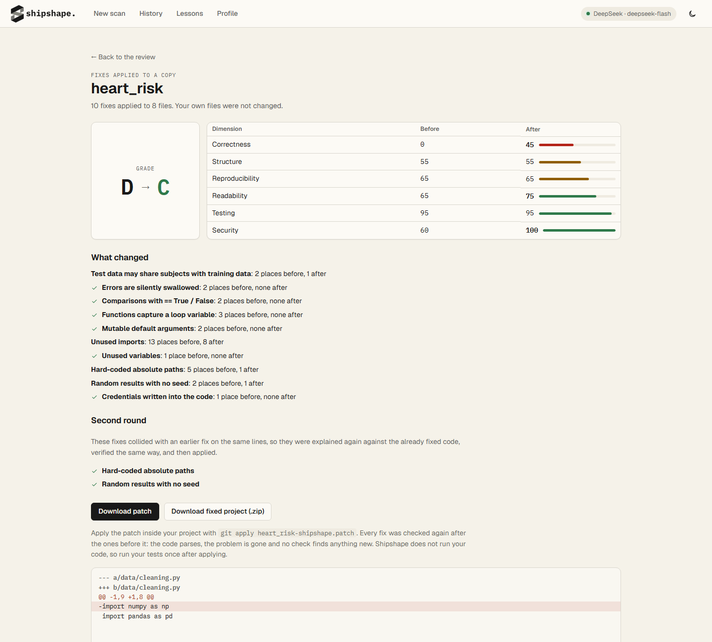
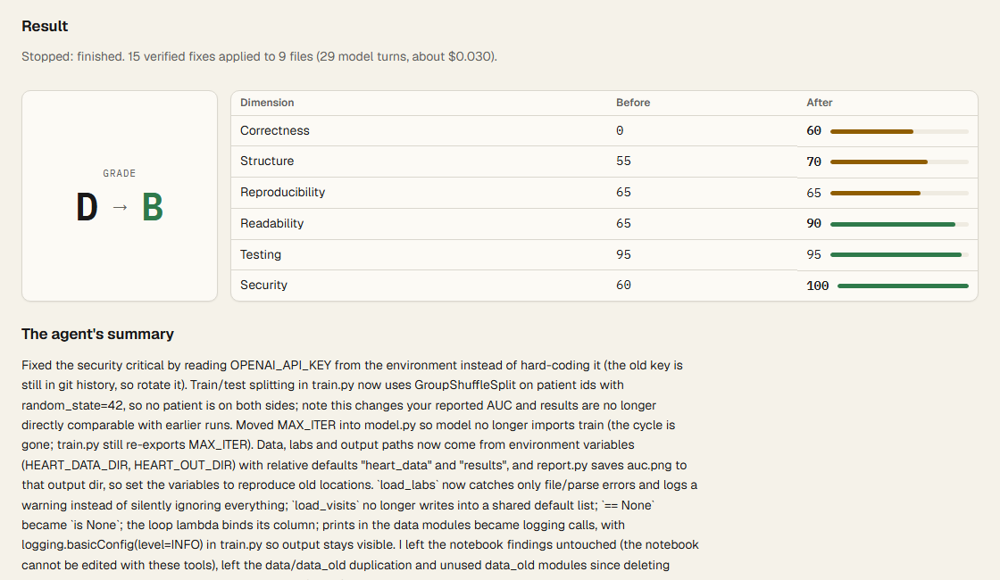

# How Shipshape works

## The checks

Shipshape reads Python files and notebooks and never runs them. 37 checks (26 of its own, 11 curated ruff rules) look at six dimensions: correctness, structure, reproducibility, readability, testing and security. Many target research and deep-learning code:

- data leakage: samples of one subject or patient on both sides of a split, including hand-made splits in notebooks;
- the test set used to pick the best epoch or for early stopping;
- training loops without `zero_grad()`, evaluation without `model.eval()`;
- data folders skipped silently when missing, `== None` on a DataFrame;
- hard-coded paths, missing seeds, unpinned dependencies, imports that only work on the author's machine;
- copied files and folders, modules nothing uses, import cycles, secrets in code.

Every finding links to one of 26 hand-written lessons on the concept behind it. Each check is measured on a corpus of small projects with planted problems (all found, no false positives) and on real research code. Every report lists files it could not read and what is already in good shape. The full list with each check's limits is in the [engine README](../engine/README.md).

## Verified fixes

With an LLM key, each finding gets a plain-language explanation in terms of your code, and where a small edit fixes it, a proposed fix. A fix is shown only if, applied in memory:

1. the edited code still parses,
2. the problem is gone from every place it was reported in the edited files, and
3. no other check reports anything new there.

Applying fixes works on a copy, one fix at a time, each verified again against the code the earlier ones left; the copy is scanned again for a before/after page and a `git apply` patch or zip.

## The agent

The agent is an LLM with four tools: list the findings, read a file, propose a fix, finish. The model decides what to look at and what to change; Shipshape decides what is accepted. Every proposed fix goes through the same three checks and is applied only if it passes, to an in-memory copy, so the next step sees the improved code. A rejected fix comes back with the reason.

Guard rails: 30 model turns, about $0.10, three rejections per finding, three files per fix, and instructions to keep the program's behaviour the same (no removed options, warnings rather than new errors). Credentials are hidden from everything the model reads; a line with a secret can be replaced by line number without the model seeing it.

## Shipshape reviewed itself

Its first self-scan found a bug in Shipshape itself (every class method counted twice) and pointed at its two most tangled functions, which were then split up. Testing on real research code found five more bugs, among them files with a byte-order mark that were skipped silently; all are fixed and covered by tests. Shipshape grades itself A.

## Privacy

Everything runs on your machine; without an LLM key nothing leaves it. With a key, only the finding and the code around it are sent, with credentials removed, and `.env` files are never sent. Where the code goes depends on the provider (DeepSeek's servers are in China; a local Ollama keeps everything local). In the Claude Code plugin, Claude reads your code under your own Claude plan.

## Limits

The checks are static heuristics: they recognise common patterns, not every way a bug can be written, and the leakage check is phrased as a question because Shipshape cannot know how your data was collected. A verified fix is valid and removes the problem without new detectable ones, but Shipshape never runs code, so run your tests after applying. Python and notebooks only.
